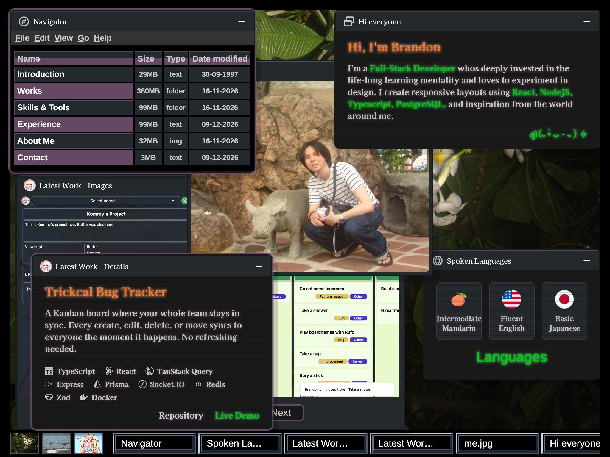

<h1 align="center">Portfolio Website</h1>
<p align="center">
    
</p>
<h3 align="center">
 Up to date as of November 25rd 2026
 <br/>
 Click <a href='https://brandonlin.netlify.app/' target="_blank">here</a> to check it out.
</h3>

### Features
- Pseudo OS
    - Drag tabs
    - Minimize tabs
    - Re-show minimized tabs using taskbar 
    - Focusing tabs (move to front)
    - Change background
    - Navigation to different tab groups using the "Navigator"
- Portfolio Info
    - Resume viewer/download
    - Social media links
    - Contact email
- 3 view modes (Mobile, Tablet, Desktop)
    - Pseudo OS features only available on Desktop

### Start commands

```bash
# Start frontend react
cd client
npm install
npm run dev

# OR
cd client
npm install
npm run build
npm run preview
```
